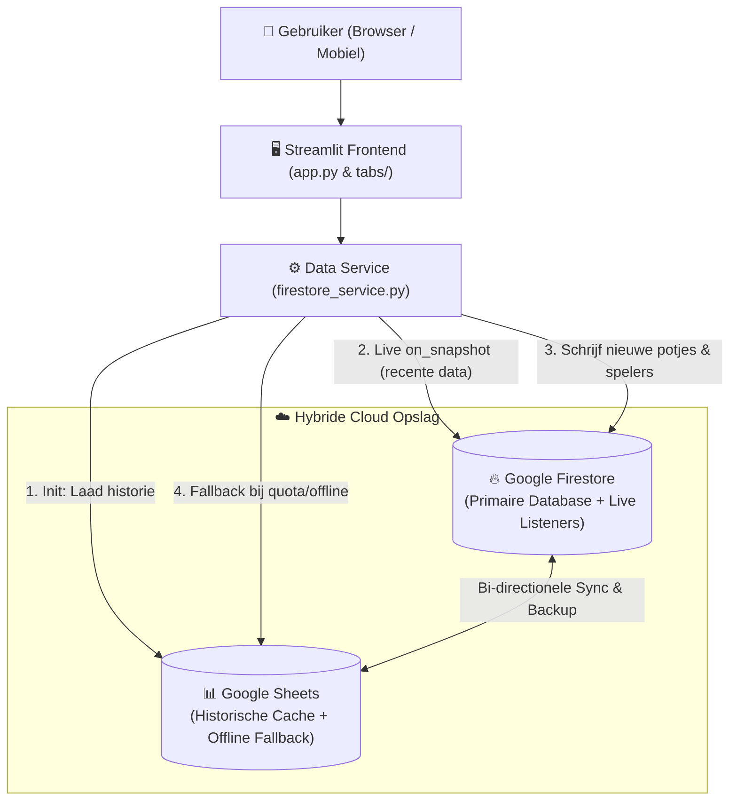

# ⚽ Tafelvoetbal Competitie App

[](https://www.python.org/downloads/)
[](https://streamlit.io)
[](LICENSE)
[](https://peps.python.org/pep-0008/)

Een real-time webapplicatie voor het registreren, analyseren en beheren van 2v2 tafelvoetbalcompetities op kantoor. Oorspronkelijk ontwikkeld tijdens de **Hackatron van oktober 2025** (ADR / Ministerie van Financiën) en sindsdien doorontwikkeld tot een robuuste, hybride cloud-applicatie.

---

## 📋 Inhoudsopgave

- [Over het Project](#-over-het-project)
- [Belangrijkste Features](#-belangrijkste-features)
- [Spelregels & ELO-Systeem](#-spelregels--elo-systeem)
- [Controlejaar (CJ) & Seizoenen](#-controlejaar-cj--seizoenen)
- [Architectuur & Dataflow](#-architectuur--dataflow)
- [Projectstructuur](#-projectstructuur)
- [Installatie & Lokale Setup](#-installatie--lokale-setup)
- [Testen](#-testen)
- [Beheer & Admin Scripts](#-beheer--admin-scripts)
- [Bijdragen (Contributing)](#-bijdragen-contributing)
- [Team & Credits](#-team--credits)
- [Licentie](#-licentie)

---

## 🎯 Over het Project

De **Tafelvoetbal Competitie App** maakt een einde aan papieren standenlijsten en losse spreadsheets. Spelers voeren direct na hun potje op hun telefoon of laptop de uitslag en eventuele *klinkers* in. De app berekent direct de nieuwe ELO-ratings, werkt de seizoensranglijst bij en biedt uitgebreide statistieken en interactieve grafieken.

Om binnen de gratis limieten (quota) van Google Cloud Firestore te blijven én altijd 100% beschikbaarheid te garanderen, maakt de app gebruik van een slimme **hybride opslagarchitectuur** met Google Firestore, real-time `on_snapshot` listeners en een automatische Google Sheets back-up & fallback.

---

## 🚀 Belangrijkste Features

### 🏠 Live Ranglijsten & Snelstart
- **Seizoensranglijst:** Real-time ELO-stand voor het huidige seizoen, inclusief gespeelde potjes, winpercentage, gemiddeld aantal goals, doelsaldo en klinkers.
- **Kwalificatiedrempel:** Spelers zijn **gerangschikt** vanaf **3 gespeelde wedstrijden** in het huidige seizoen (de top 3 wordt groen gemarkeerd; spelers met < 3 potjes staan cursief).
- **Trendindicatoren:** Direct inzicht in de ELO-mutatie (`+` groen / `-` rood) ten opzichte van de vorige gespeelde wedstrijd.
- **Ingebouwde Snelstart:** Nieuwe spelers kunnen op het Home-scherm en in het tabblad **ℹ️ Colofon & Uitleg** direct een interactieve **Snelstart & Tutorial** raadplegen.

### 📝 Slimme Wedstrijdregistratie
- **2v2 Invoer:** Kies 4 unieke spelers (Thuis 1 & 2 vs. Uit 1 & 2) en voer de eindstand in (één team scoort 10 doelpunten, het andere 0 t/m 9).
- **Klinkers & ELO-bonus:** Registreer direct gescoorde klinkers per speler (+15 ELO-bonus per klinker).
- **Duplicaatdetectie:** Waarschuwt automatisch als dezelfde teams en score al binnen 24 uur zijn geregistreerd, om dubbele invoer te voorkomen.
- **10-0 Feestje:** Bij een *whitewash* (10-0 of 0-10) vliegen de ballonnen over het scherm! 🎈

### 📈 Uitgebreide Analytics & Spelerhistorie
- **All-time Recordhouders:** Prominente weergave van de hoogste ELO ooit behaald (*Peak ELO*).
- **8 Top-5 Leaderboards:** Top 5 overzichten voor Peak ELO, Topscorers, Meest Actief, Overwinningen, Klinker Masters, Win%, Goals per Wedstrijd en Doelsaldo.
- **Interactieve Grafieken (Plotly):** ELO-ontwikkeling per speler over de tijd, Activiteit vs. Winpercentage scatterplots, doelpunten per seizoen en speeldag-tijdlijnen.

### 💾 Hybride Data, Caching & Uitgestelde Herberekening
- **Google Sheets Sync & Fallback:** Historische data wordt bij opstarten uit de [Google Sheet Back-up](https://docs.google.com/spreadsheets/d/1cCiNoYfro9SqS8qIjEKT8prsAvAA7wowvhzhh2ljHnA) geladen om Firestore-reads te besparen. Als Firestore tijdelijk niet bereikbaar is, schakelt de app naadloos over naar **Offline Modus** (lezen en schrijven via Google Sheets).
- **Uitgestelde ELO-herberekening (23:00 uur):** Wanneer een beheerder een historische wedstrijd wijzigt of verwijdert, wordt de ketting-herberekening van alle opvolgende wedstrijden automatisch ingepland voor **23:00 uur 's avonds**, zodat de database overdag snel en binnen de quota blijft.

---

## 🧮 Spelregels & ELO-Systeem

Elke speler start aan het begin van een nieuw seizoen met **1000 ELO-punten**. Na elke 2v2-wedstrijd wordt de rating van alle vier de spelers bijgewerkt.

### De Formule

$$\text{Nieuwe ELO} = \text{Oude ELO} + K \times \text{Impact} \times (\text{Resultaat} - \text{Verwachting}) + (\text{Klinkers} \times 15)$$

1. **Verwachte Score ($\text{Verwachting}$):**
   De winstkans van speler $X$ tegen tegenstanders $Y$ en $Z$ wordt berekend als het gemiddelde van de individuele verwachtingen (schaalfactor 500):
   $$E(X, Y) = \frac{1}{1 + 10^{(R_Y - R_X) / 500}}, \quad \text{Verwachting}_X = \frac{E(X, Y) + E(X, Z)}{2}$$
2. **Werkelijk Resultaat ($\text{Resultaat}$):**
   `1.0` bij winst, `0.0` bij verlies, `0.5` bij gelijkspel (in reguliere potjes tot de 10 is gelijkspel uitgesloten).
3. **Scoreverschil ($\text{Impact}$):**
   Grote overwinningen tellen zwaarder mee op een logaritmische schaal:
   $$\text{Impact} = 2 + \left(\frac{\log_{10}(\Delta \text{score} + 1)}{\log_{10}(10)}\right)^3 = 2 + \left(\log_{10}(\Delta \text{score} + 1)\right)^3$$
   *(Bij 10-9 is het verschil 1 en de impact $\approx 2.03$; bij 10-0 is het verschil 10 en de impact $\approx 3.13$.)*
4. **Dynamische K-factor ($K$):**
   Nieuwe spelers stijgen en dalen sneller zodat ze snel hun juiste niveau bereiken. Naarmate een speler meer wedstrijden ($N$) in het huidige seizoen speelt, stabiliseert de K-factor:
   $$K = \frac{50}{1 + N / 300}$$
5. **Klinker-bonus:**
   Elke gescoorde **klinker** levert direct **+15 ELO-punten** op voor de betreffende speler, ongeacht winst of verlies.

---

## 📅 Controlejaar (CJ) & Seizoenen

De competitie volgt de officiële **ADR Controlejaar-systematiek** (15 maart t/m 15 maart), opgedeeld in twee seizoenen per jaar:

| Seizoen | Startdatum | Einddatum |
| :--- | :--- | :--- |
| **☀️ Zomerseizoen** (`CJ <Jaar> Zomer`) | **15 maart** (00:00 uur) | **Woensdag na Prinsjesdag** (dinsdag 23:59:59) |
| **❄️ Winterseizoen** (`CJ <Jaar> Winter`) | **Woensdag na Prinsjesdag** (00:00 uur, direct na de 3e dinsdag van sept.) | **14 maart** volgend jaar (23:59:59) |

> **🔄 Automatische Seizoensreset:** Zodra de allereerste wedstrijd van een nieuw seizoen wordt ingevoerd, detecteert de app dit automatisch en worden alle speler-ELO's gereset naar **1000 punten**. Historische prestaties en *Peak ELO's* blijven volledig bewaard in het tabblad **📈 Analytics**.

---

## 🏗️ Architectuur & Dataflow



---

## 📁 Projectstructuur

```text
tafelvoetbal/
├── app.py                      # Hoofd-entrypoint van de Streamlit applicatie
├── styles.py                   # Huisstijl (ADR roze & MinFin blauw), CSS & mobiele optimalisatie
├── firestore_service.py        # Database-laag, Firestore listeners, Google Sheets sync & ELO-recalc
├── analytics.py                # Gevectoriseerde Pandas-berekeningen & Plotly visualisaties
├── requirements.txt            # Python dependencies
├── pytest.ini                  # Pytest configuratie
├── tabs/                       # UI-modules per tabblad
│   ├── tab_home.py             # 🏠 Home: Snelstart, huidige ELO-ranglijst & laatste 10 uitslagen
│   ├── tab_invullen.py         # 📝 Invullen: Wedstrijdformulier, validatie & duplicaat-check
│   ├── tab_spelers.py          # 👥 Spelers: ELO-ontwikkeling grafiek & spelers toevoegen/verwijderen
│   ├── tab_analytics.py        # 📈 Analytics: Recordhouders, seizoensoverzicht & 8 Top-5 borden
│   ├── tab_data.py             # 📊 Ruwe Data: Inzicht en CSV-export van alle tabellen
│   ├── tab_verzoeken.py        # 💬 Verzoeken: Wensen, bugs en ideeën indienen
│   ├── tab_commits.py          # 📜 Commits: Vertaalde Git-wijzigingshistorie
│   ├── tab_logging.py          # 🔍 Logging: Beheer-logboek & live Firestore operaties
│   ├── tab_colofon.py          # ℹ️ Colofon & Uitleg: Handleiding, snelstart, ELO-formules & credits
│   └── tab_beheer.py           # ⚙️ Beheer: Wachtwoordbeveiligd beheer (wijzigen, wissen, CSV-upload)
├── utils/                      # Gedeelde hulpfuncties
│   ├── utils.py                # Validatie van spelersnamen, tijdzone (Europe/Amsterdam) & helpers
│   ├── utils_new_elo.py        # Kernformules voor de 2v2 ELO-berekening en klinker-bonus
│   ├── utils_seizoen.py        # Prinsjesdag & 15-maart seizoensberekening
│   └── utils_beheer_log.py     # Audit-logging voor beheerdersacties
├── admin/                      # Standalone CLI-scripts voor database-onderhoud & audits (zie admin/README.md)
└── tests/                      # Unit- en integratietests (Pytest)
```

---

## 🔧 Installatie & Lokale Setup

### Vereisten
- **Python 3.10** of hoger
- Een Google Cloud Service Account met rechten op **Cloud Firestore** en de **Google Sheets / Drive API** (voor volledige online modus).

### Stappenplan

1. **Clone de repository:**
   ```bash
   git clone https://github.com/atv22/tafelvoetbal.git
   cd tafelvoetbal
   ```

2. **Maak een virtuele omgeving aan en activeer deze:**
   ```powershell
   # Windows (PowerShell)
   python -m venv .venv
   .\.venv\Scripts\Activate.ps1

   # macOS / Linux
   python3 -m venv .venv
   source .venv/bin/activate
   ```

3. **Installeer de benodigde packages:**
   ```bash
   pip install -r requirements.txt
   ```

4. **Configureer Google Authenticatie:**
   Je kunt op twee manieren authenticeren:
   - **Optie A (Lokaal sleutelbestand):** Plaats het service-account JSON-bestand als `firestore-key.json` in de hoofdmap van het project.
   - **Optie B (Streamlit Secrets):** Maak `.streamlit/secrets.toml` aan met daarin `[firestore_credentials]` en optioneel `GSHEET_ID = "..."`.
   *(Let op: zowel `firestore-key.json` als `.streamlit/secrets.toml` staan in `.gitignore` en mogen nooit naar Git worden gepusht!)*

5. **Start de applicatie:**
   ```bash
   streamlit run app.py
   ```
   De app opent nu automatisch in je browser op `http://localhost:8501`.

---

## 🧪 Testen

Het project beschikt over een uitgebreide testsuite in de map `tests/` (waaronder tests voor de ELO-wiskunde, seizoensovergangen, uitgestelde herberekeningen en UI-structuur).

```powershell
# Voer alle snelle unit-tests uit (zonder live database-integratietests):
pytest -m "not integration"

# Voer de volledige testsuite uit (inclusief Firestore/Sheets integratietests):
pytest
```

---

## 🛠️ Beheer & Admin Scripts

Voor dagelijks beheer biedt het tabblad **⚙️ Beheer** in de app (beveiligd met wachtwoord) functies om:
- Google Sheets en Firestore handmatig te synchroniseren;
- Wedstrijden te bewerken of te verwijderen (met automatische ELO-herberekening om 23:00 uur);
- Spelersnamen in de gehele historie te corrigeren;
- Historische data via CSV te importeren.

Voor zwaardere database-operaties (zoals het samenvoegen van dubbele spelers, het forceren van een ELO-herberekening via cron, of het exporteren van alle collecties) zijn er standalone scripts beschikbaar in de map [`admin/`](admin/README.md). Bekijk [`admin/README.md`](admin/README.md) voor een volledig overzicht.

---

## 🤝 Bijdragen (Contributing)

Bijdragen, bugmeldingen en nieuwe ideeën zijn van harte welkom!
- Gebruik in de app het tabblad **💬 Verzoeken** om snel een wens of bug achter te laten.
- Wil je zelf code bijdragen? Lees dan eerst onze [Contributing Guidelines (CONTRIBUTING.md)](CONTRIBUTING.md) voor afspraken over branches, code-stijl en tests.

---

## 🏆 Team & Credits

Ontwikkeld tijdens de **Hackatron van oktober 2025** door:
- **Rick**
- **Bernd**
- **Dewi**
- **Isis**
- **Arthur**
- **Johannes**

Met ondersteuning van AI-pair programming voor continue optimalisatie en onderhoud.

---

## 📄 Licentie

Dit project is vrijgegeven onder de [MIT License](LICENSE).
